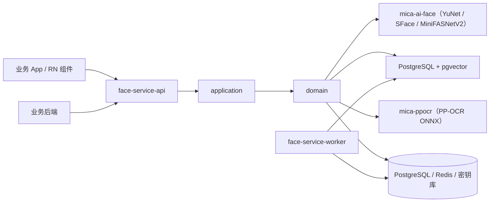

# 人脸核验平台（Facial Liveness Verification）

面向公司内部多业务的人脸核验能力服务，提供无状态人脸 1:1、静默活体、人脸档案 1:1、1:N 检索和证件 OCR，供 KYC 与敏感操作二次验证复用。

> 状态：最小全链路已实现并冒烟通过（2026-11-14）：Maven 多模块 + Spring Boot API（dev token / challenges /
> action-check / enrollments / verifications，真实 mica-ai-face 引擎）+ H5 联调页。1:1 检索（identify）、证件 OCR、Worker
> 异步任务、对象存储留档为后续批次。2026-11-14 技术栈由 .NET（ViewFaceCore）切换为 Spring Boot + mica-ai-face，构建经
> Kotlin Toolchain 过渡后统一为标准 Maven（详见需求 0001 方案评估修订记录）；此前的 .NET 实现与验证记录已作废，过程留存见
> `docs/功能/04-验证与已知限制.md` 与需求 0001 方案评估。

## 功能概览

| 能力       | 说明                                         | 是否存储人脸数据 |
|------------|----------------------------------------------|------------------|
| 无状态 1:1 | 参考图 + 现场帧比对，适合 KYC 人证比对       | 否               |
| 静默活体   | 基于连续视频帧判断真人或攻击介质             | 否               |
| 人脸档案   | 录入加密特征，后续做 1:1 验证                | 是，仅特征       |
| 1:N 检索   | 在指定 gallery 内检索候选，返回分数与 margin | 是，仅特征       |
| 证件 OCR   | 识别证件字段、规则校验，可选人证 1:1         | 按租户策略       |

## 系统架构



入口、外部系统、数据存储与异步任务的职责见 `docs/功能/01-项目架构.md`，系统边界与运行时链路见 `docs/架构全景图.md`。

## 服务清单

| 服务                | 入口（规划）                                                                         | 默认端口 | 职责                                                         |
|---------------------|--------------------------------------------------------------------------------------|----------|--------------------------------------------------------------|
| face-service-api    | `face-service-api/pom.xml`（spring-boot-maven-plugin）                                | 8080     | HTTP API、JWT 鉴权、Actuator 健康探针（限流/OpenAPI 未启用） |
| face-service-worker | 未创建                                                                               | 无       | 异步任务、过期清理、索引重建（下一批次）                     |
| 本地采集页          | `face-service-api/resources/static/dev/face-test.html`                               | 8080     | 仅 dev profile 的 H5 验证页                                  |

## 目录结构

```text
.
├── README.md
├── AGENTS.md
├── pom.xml                      # Maven 多模块（依赖版本集中仲裁）
├── mvnw                         # Maven Wrapper
├── face-service-api/            # HTTP 入口（5 条路由 + dev H5）
├── face-service-application/    # 用例编排（token/challenge/action/enroll/verify）
├── face-service-domain/         # 领域接口与值对象
├── face-service-infrastructure/ # mica-ai-face 适配、AES-GCM、密钥库、MP 持久层
├── face-service-contracts/      # 错误码与 DTO
├── face-service-worker/         # 未创建（异步任务批次）
├── deploy/                      # docker-compose.dev.yml + initdb（DDL 按序 + dev 种子）
│   （模型内嵌于 face-service-api/src/main/resources/models/，.gitignore 不入库）
└── docs/
```

## 技术栈

| 类别          | 选型                                                 | 说明                                                                                              |
|---------------|------------------------------------------------------|---------------------------------------------------------------------------------------------------|
| 运行时        | Java 25（最低标准，Temurin）                         | Spring Boot 3.5.x 官方支持 JDK 25 LTS                                                             |
| 构建         | 标准 Maven 多模块（`pom.xml` + `mvnw`）              | SB BOM 3.5.7 集中仲裁依赖版本；`spring-boot-maven-plugin` 产出可执行 jar                          |
| Web           | Spring Boot 3.5.x（Web MVC + Validation + Actuator） | 统一 `/v1` 前缀                                                                                   |
| 人脸引擎      | `net.dreamlu:mica-ai-face-spring-boot-starter`       | YuNet 检测 + SFace 128d 特征 + MiniFASNetV2 活体 + 头像/证件卡片提取；Apache-2.0，纯 ONNX Runtime |
| OCR           | `net.dreamlu:mica-ppocr`                             | PP-OCR ONNX 推理，Apache-2.0（以仓库 LICENSE 为准）                                               |
| 数据访问      | MyBatis-Plus                                         | CRUD/分页；pgvector 向量列用 TypeHandler 适配                                                     |
| 向量检索      | PostgreSQL + pgvector                                | HNSW + cosine，`vector(128)`（SFace 128d）                                                        |
| 缓存          | Redis（Spring Data Redis）                           | challenge、jti、限流                                                                              |
| 对象存储      | 本地开发 RustFS / 线上 Cloudflare R2                 | 均为 S3 兼容 API，AWS SDK for Java v2 同一实现接入；私有读 + 短时效预签名                         |
| JWT           | jjwt                                                 | 端上短期令牌与结果令牌的签发/验签                                                                 |
| 部署          | Docker + Linux glibc（eclipse-temurin:25 基础）      | macOS 因 openpnp 原生库可直接本地跑真实引擎                                                       |

## 环境要求

- JDK 25（Temurin，最低标准）、Maven 3.9+（仓库自带 `mvnw`）
- PostgreSQL 16 及以上，安装 pgvector 扩展
- Redis 7 及以上
- 本地开发依赖一键创建：`deploy/docker-compose.dev.yml`（PostgreSQL+pgvector、Redis、RustFS）；线上对象存储为 Cloudflare R2
- 模型文件已内嵌：`face-service-api/src/main/resources/models/`（classpath 加载，`.gitignore` 不入库；从 mica-ai 上游仓库获取）

## 快速开始

### 本地开发依赖（规划）

```bash
# 首次使用：复制凭据模板并替换全部占位值（生成强凭据：openssl rand -base64 24；主密钥 openssl rand -base64 32）
cp deploy/dev.env.example deploy/.env

# 启动 PostgreSQL(+pgvector)、Redis、RustFS
docker compose -f deploy/docker-compose.dev.yml up -d

# 验证
curl --fail http://localhost:9000/health                  # RustFS 健康
docker exec faceservice-postgres psql -U faceservice -d faceservice -c '\dt'   # 11 张 face_* 表
```

- DDL 仅在数据卷首次初始化时按外键依赖顺序自动执行（单一来源 `docs/需求/0001/sql/`，顺序控制见
  `deploy/initdb/01-run-ddl.sh`，规划）。
- 重新初始化：`docker compose -f deploy/docker-compose.dev.yml down -v` 后再 `up -d`。
- 本机端口被占用时改 `deploy/.env` 中的 `POSTGRES_PORT` / `REDIS_PORT`（`deploy/.env` 已被 `.gitignore` 拦截）。

### 服务运行（已验证，2026-11-14）

```bash
# 前置：模型文件在 models/（见 models/README，缺失启动即失败）；
# Redis 宿主端口冲突时在 deploy/.env 设 REDIS_PORT=16379（本机现状）
docker compose -f deploy/docker-compose.dev.yml up -d   # PG+pgvector / Redis / RustFS

./mvnw -DskipTests package
SPRING_PROFILES_ACTIVE=dev REDIS_PORT=16379 \
java -jar face-service-api/target/face-service-api.jar
# 启动即从 classpath 加载三个 ONNX 模型（YuNet / SFace / MiniFASNetV2），约 2.5s

# 浏览器打开全链路联调页（录入→认证，同源无 CORS）：
#   http://localhost:8080/dev/face-test.html
```

浏览器打开 `http://localhost:8080/dev/face-test.html`（仅 dev profile）。`/dev/token` 与 `/dev/*` 只在 `dev` profile 且 `
auth.enable-dev-token=true` 双条件满足时注册，生产环境必须不可用（有启动校验）。

### Docker 运行（规划值）

```bash
docker build -t faceservice:dev -f deploy/Dockerfile .
# 模型目录只读挂载，路径经环境变量或配置文件注入（mica.ai.face.model.*）
docker run --rm -p 8080:8080 \
  -e SPRING_PROFILES_ACTIVE=dev \
  -e AUTH_MODE=dev-token \
  -e AUTH_ENABLE_DEV_TOKEN=true \
  faceservice:dev
```

## 接口约定

- 统一前缀 `/v1`；JSON 与 `multipart/form-data`。
- 服务间调用：内网 mTLS 或 `client_id + HMAC + timestamp + nonce`。
- 端上调用：业务后端签发 5 分钟短期 JWT，claims 包含 `tenant`、`sub`、`scene`、`ref`、`ops`、`gallery`、`jti`。
- 响应统一为 `{code, message, request_id, details}`；错误码机器可读。
- `challenge_id` 一次性、5 分钟过期；写接口支持 `Idempotency-Key`。
- 同步接口 P95 目标 3 秒；批量、OCR、1:N 支持 `202 + webhook`。

## 配置说明

| 配置组                  | 关键字段（Spring 属性）                                                                                     | 说明                                                           |
|-------------------------|-------------------------------------------------------------------------------------------------------------|----------------------------------------------------------------|
| `auth.*`                | `mode`、`enable-dev-token`、`dev-signing-key`                                                               | 生产只允许 `jwt`；DevToken 双条件（dev profile + 开关）        |
| `face.*`                | `match-threshold`、`liveness.*`、`identify.*`                                                               | 判定阈值与帧数策略（无引擎选择项，只有真实实现）               |
| `mica.ai.face.*`        | `model.detection.path`、`model.recognition.path`、`model.liveness.path`                                     | mica-ai-face 模型路径与引擎参数，未配置启动即失败              |
| `spring.datasource.*`   | `url`、`username`、`password`                                                                               | PostgreSQL 连接                                                |
| `face.vector.dimension` | `128`                                                                                                       | 必须与 pgvector 列维度一致                                     |
| `spring.data.redis.*`   | `host`、`port`、`password`                                                                                  | 会话、jti、限流                                                |
| `storage.*`             | `enabled`、`endpoint`、`bucket`、`region`、`access-key`、`secret-key`、`force-path-style`、`signed-url-ttl` | 本地 RustFS / 线上 R2 走同一 S3 兼容实现；凭据只走环境变量     |
| `retention.*`           | `session-hours`、`image-days`、`profile-days`                                                               | 留存与清理                                                     |
| `security.*`            | `master-key`、`allowed-origins`                                                                             | 租户密钥落库（`face_tenant_keys`，主密钥环境变量注入包裹密文） |

真实凭据不写入仓库，使用环境变量或密钥管理服务。

## 测试

- **测试尚未编写（当前最大缺口）**：规划为 `./mvnw test`，单元（JUnit 5 + Mockito stub
  接口）覆盖策略、阈值、错误码、JWT、租户隔离；集成（Testcontainers）依赖 PostgreSQL 与 Redis，并直接加载真实 mica-ai-face
  模型。当前质量依据：`./mvnw -DskipTests package` + 运行时冒烟（见 docs/功能/04）。
- 本地 H5 验证依赖摄像头；当前未执行。
- 未运行的验证项必须写明原因，不得写成已通过。

## 部署

- Docker 基础镜像使用 `eclipse-temurin:25-jre`（Debian/Ubuntu glibc），不使用 Alpine/musl（OpenCV 原生库依赖 glibc）。
- 模型目录只读挂载，启动时校验 sha256 与模型版本。
- 健康探针：Actuator `/actuator/health/liveness`、`/actuator/health/ready`；就绪探针需等待模型预热完成。
- 多实例部署；ONNX 推理按实例占用 CPU，横向扩容 + 有界队列削峰。

## 开发规范

- 分层：`api` 只做鉴权、校验、响应；用例在 `application`；领域接口与实体在 `domain`；外部实现在 `infrastructure`。根包
  `faceservice`，按层分包。
- 人脸引擎通过 `FaceEngine` 接口隔离，业务层不直接依赖 mica-ai 类型。
- 向量检索通过 `FaceIndex` 接口隔离，首期实现 pgvector；租户过滤由 MyBatis-Plus `TenantLineInnerInterceptor` 从 JWT
  上下文强制注入。
- 阈值、帧数、留存周期全部配置化（`@ConfigurationProperties` record 绑定），按租户覆盖。
- DTO 用 `record`、构造器注入、SLF4J 占位符日志；日志不输出人脸图片、特征、证件号、完整姓名等敏感信息。
- 代码风格 4 空格 / 120 列，以《阿里巴巴 Java 开发手册》为底线；静态检查门禁（Spotless/P3C）待接入，当前以 IDE 与 CI 约定执行。

## 安全须知

- 租户身份只从 JWT/签名获取，不信任请求体中的 `tenant`。
- `jti` 一次性；challenge 绑定 `tenant + sub + scene + ref + device`。
- 人脸特征与证件字段加密存储，按租户派生密钥；主密钥不进数据库与代码库。
- `verification_token` 由平台签名，业务后端验签并原子消费。
- `/dev/token`、`/dev/face-test.html` 仅 dev profile 可用；CI 检查生产配置不得出现 `auth.enable-dev-token=true`。

## 已知限制

- 后端尚未实现，本 README 中所有运行命令与端口为规划值；dev H5 页面为纯静态资源，可先行预览。
- mica-ai-face 社区较新（2026-11-14 约 29 stars），需锁定版本、审读关键源码并建立升级评估流程。
- 开源静默活体（MiniFASNetV2）对屏幕翻拍、打印、Deepfake 的泛化有限，需配合挑战、频控与设备风控。
- 证件 OCR 只能保证字段识别，不验证证件真伪；全息、UV、纸张纹理等防伪不在开源 OCR 范围。
- 1:N 检索的误识别风险高于 1:1，接近阈值的命中必须转人工复核。
- 项目许可证尚未声明；第三方组件许可证见 `docs/功能/04-验证与已知限制.md`。
