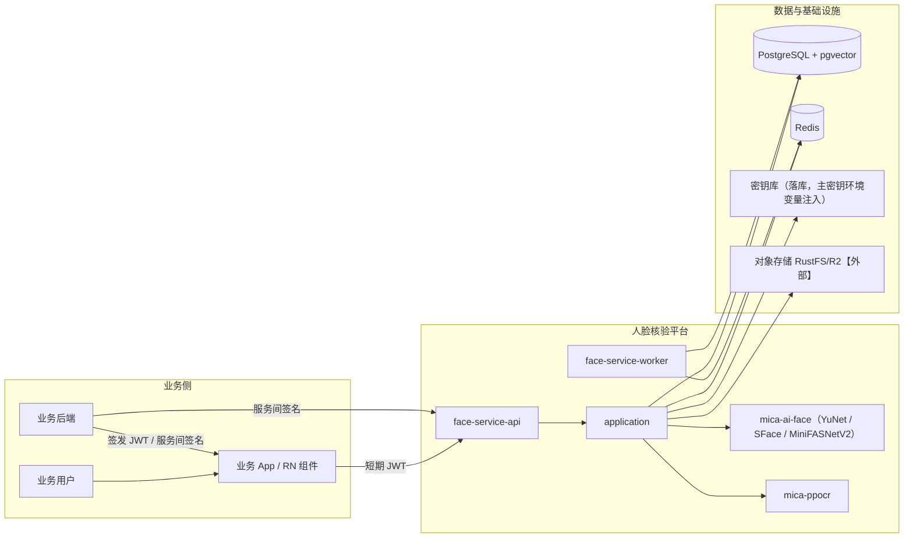
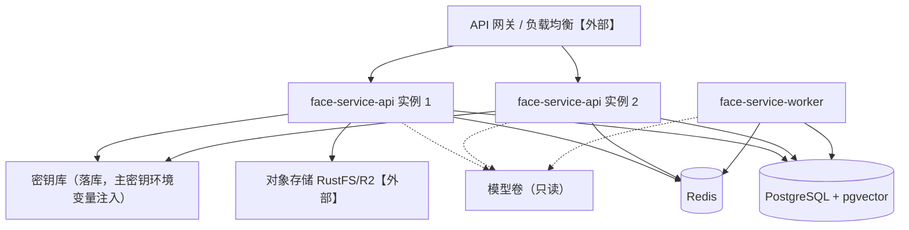
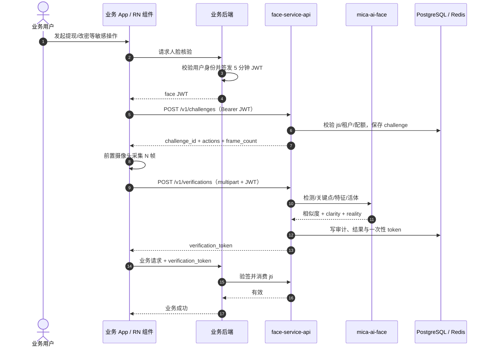
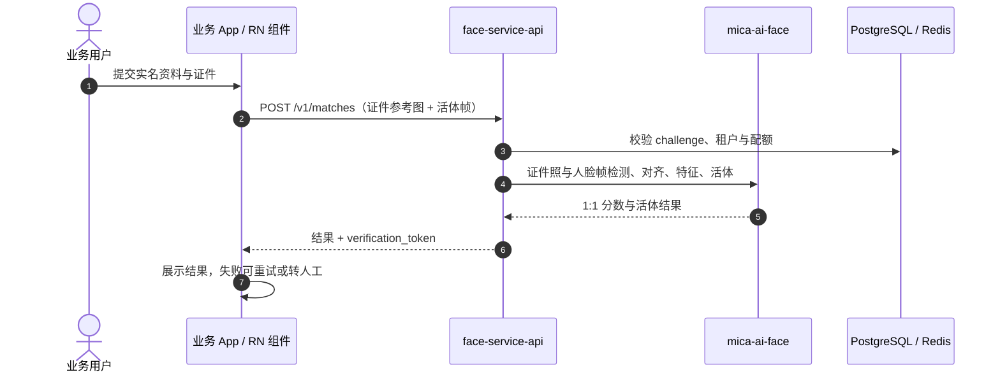

# 架构全景图

> 项目：人脸核验平台
> 状态：设计稿，待评审
> 证据基线：技术栈切换评审（2026-11-14，Spring Boot + mica-ai-face），尚无实现代码

本文件只回答系统由谁组成、部署在哪里、一次核验请求如何流动；组件职责、启动顺序与数据表见 `功能/01-项目架构.md`。

## 1. 系统上下文

边界说明：

- 业务后端负责用户登录态与业务鉴权，向 App 签发 5 分钟 JWT；平台只校验 JWT，不校验用户密码。
- 平台不保存业务用户资料，只保存 `tenant + subject_id` 与人脸特征。
- 密钥库与对象存储通过接口访问；密钥库落库（租户密钥存 `face_tenant_keys`，主密钥只从环境变量注入）；对象存储统一走 S3 兼容
  API：本地开发为 RustFS，线上为 Cloudflare R2，凭据不进仓库。
- 1:N 检索在同一租户的 gallery 内进行，不跨租户。

## 2. 部署拓扑

部署约束：

- 基础镜像使用 eclipse-temurin（Debian/Ubuntu glibc），不使用 Alpine/musl（OpenCV 原生库依赖 glibc）。
- mica-ai-face 模型与 OpenCV 原生库随镜像或只读卷提供；启动时校验 sha256。
- ONNX 推理占用 CPU，靠多实例与有界队列扩容，不靠单进程高并发。
- Worker 与 API 可同镜像不同入口，也可独立扩缩容。

## 3. 运行时链路

### 3.1 敏感操作人脸验证

### 3.2 KYC 人证比对

证件图由业务侧上传到平台或平台可访问的私有存储；平台不把证件图暴露为公网地址。

## 4. 外部依赖

| 依赖                                      | 用途                      | 故障时行为                           |
|-------------------------------------------|---------------------------|--------------------------------------|
| 密钥库（落库）                            | 租户密钥、特征加密        | 密钥不可用即拒绝写入特征，不降级明文 |
| PostgreSQL                                | 档案、审计、向量          | 读写失败，返回服务不可用             |
| Redis                                     | challenge、jti、限流      | 降级为拒绝新会话，不绕过校验         |
| 对象存储【外部】（本地 RustFS / 线上 R2） | 可选原图留存，S3 兼容 API | 仅影响复核能力，不影响 1:1 判定      |
| 业务后端                                  | 签发 JWT、消费结果        | 无法发起新核验，已发起会话可完成     |
