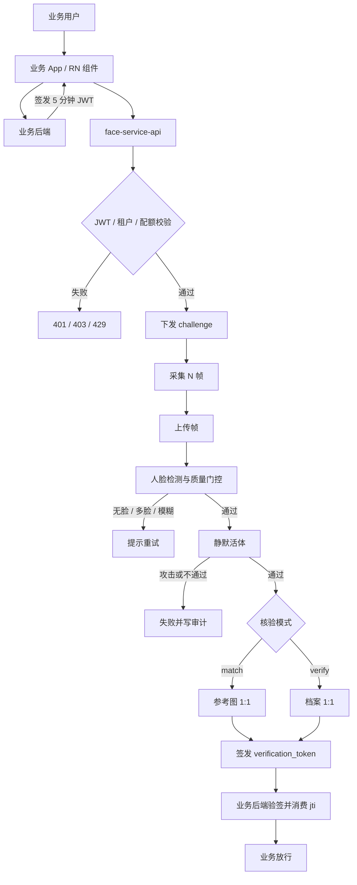
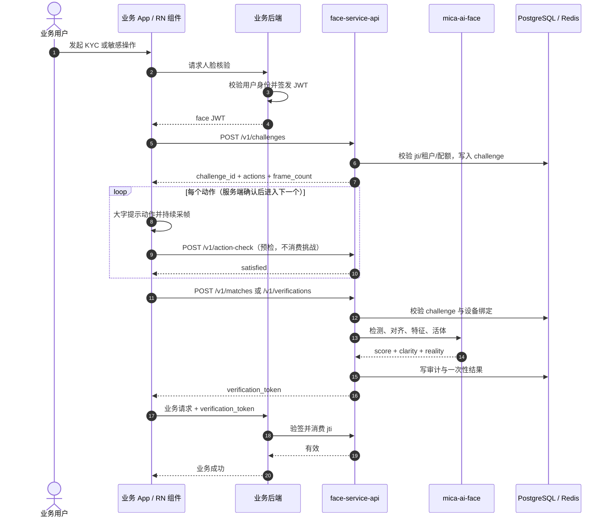
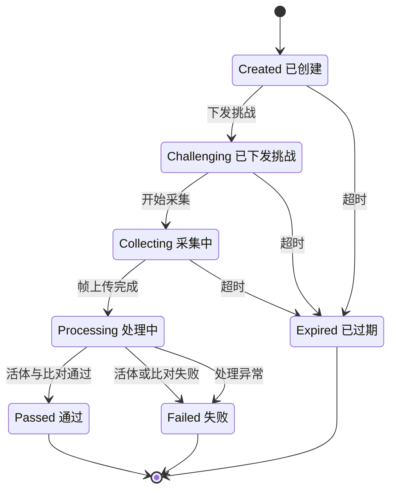

# 01 人脸采集与核验（v2）

> 文档编号：01
> 文档版本：v2
> 修订记录：v2（2026-11-14）——挑战升级为随机主动动作序列（straight + 转头/张嘴），采集改为逐动作门控（服务端预检确认后才进入下一个动作），新增 `/v1/action-check` 预检；v1 为 .NET 时期初稿。
> 项目：人脸核验平台
> 关联接口：`POST /v1/challenges`、`POST /v1/matches`、`POST /v1/verifications`
> 状态：设计稿，待实现
> 证据基线：技术栈切换评审（2026-11-14，Spring Boot + mica-ai-face），尚无实现代码

## 1. 流程目标

业务 App 在 KYC 或敏感操作前完成一次人脸采集，由平台判定活体与 1:1 结果，并向业务后端签发可消费的一次性结果令牌。

## 2. 参与角色与前置条件

| 角色 | 职责 |
| --- | --- |
| 业务用户 | 授权同意、按提示完成采集 |
| 业务 App / RN 组件 | 申请 challenge、采集帧、上传、展示结果 |
| 业务后端 | 校验用户身份、签发 5 分钟 JWT、消费结果令牌 |
| face-service-api | 验签、租户与配额校验、编排用例、签发结果 |
| mica-ai-face | 检测、关键点、特征、静默活体、动作几何校验 |
| PostgreSQL / Redis | 档案、审计、challenge、jti、限流 |

前置条件：

- 租户已注册并启用，端上持有业务后端签发的有效 JWT。
- 用户已完成人脸采集授权同意（KYC 或敏感操作场景）。
- `challenge` 未过期、未被使用，设备与 JWT 绑定一致。
- `match` 需要参考图；`verify` 需要主体已存在 `Active` 档案。

## 3. 主流程图

## 4. 时序图

## 5. 状态机

状态由平台写入；`Passed` 之后结果令牌仍需业务后端消费，消费前不代表业务已放行。

## 6. 关键异常与分支

| 场景 | 处理 |
| --- | --- |
| JWT 过期、签名错误、租户停用 | 401/403，不创建会话 |
| jti 重放 | 拒绝并写审计 |
| challenge 过期或被使用 | 返回过期错误，要求重新申请 |
| 无人脸、多人脸 | 返回明确错误码，提示重拍 |
| 清晰度不足（Fuzzy） | 提示补光或稳定后重拍，不计入失败次数 |
| 活体判定为攻击 | 拒绝，记录设备与 IP，按策略风控 |
| 1:1 相似度不足 | 允许重试；超过次数转人工或兜底 |
| 主动动作超时/未达标（ACTION_MISMATCH） | 立即失败并指名动作，重试该动作 |
| 参考图缺失或非法 | 拒绝 `match`，提示业务侧补齐 |
| 档案不存在 | 返回未录入，引导先 enroll |
| 模型不可用或超时 | 返回服务不可用，按策略降级，不绕过活体 |

## 7. 证据索引

| 证据 | 位置 |
| --- | --- |
| 接口契约 | `docs/需求/0001/0001-人脸核验平台-实施方案.md` |
| 前端契约 | `docs/需求/0001/0001-人脸核验平台-前端对接文档.md` |
| 架构边界 | `docs/架构全景图.md` |
| 组件职责 | `docs/功能/01-项目架构.md` |
| 术语口径 | `docs/功能/03-领域术语表.md` |
| 代码与测试 | 尚不存在，待实现后补充 |

## 8. 实现风险与待确认

- 帧数以服务端下发为准，客户端不得自行降低；平台默认活体融合帧数为 10（多帧投票）。
- ONNX 推理占用 CPU，峰值流量需要排队与限流，不能无限并发。
- 设备绑定字段尚未确定，需与业务 App 的设备指纹方案对齐。
- 重试次数、是否允许密码兜底、人工复核入口由租户策略决定，尚未定值。
- 原始帧是否留存、留存天数与删除方式需按租户合规要求确认。
