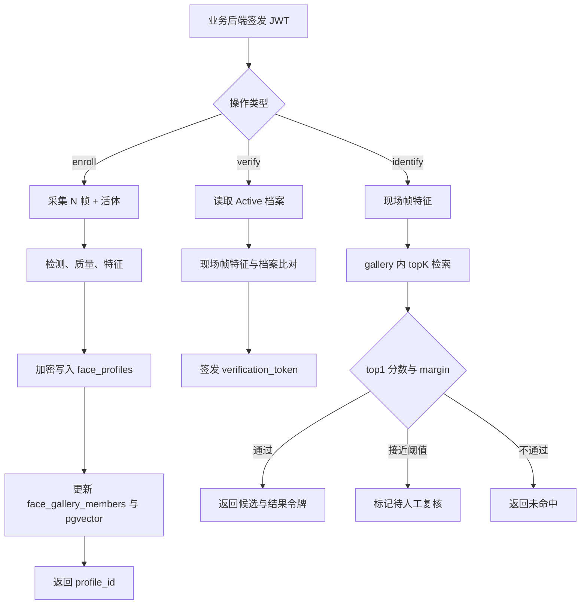
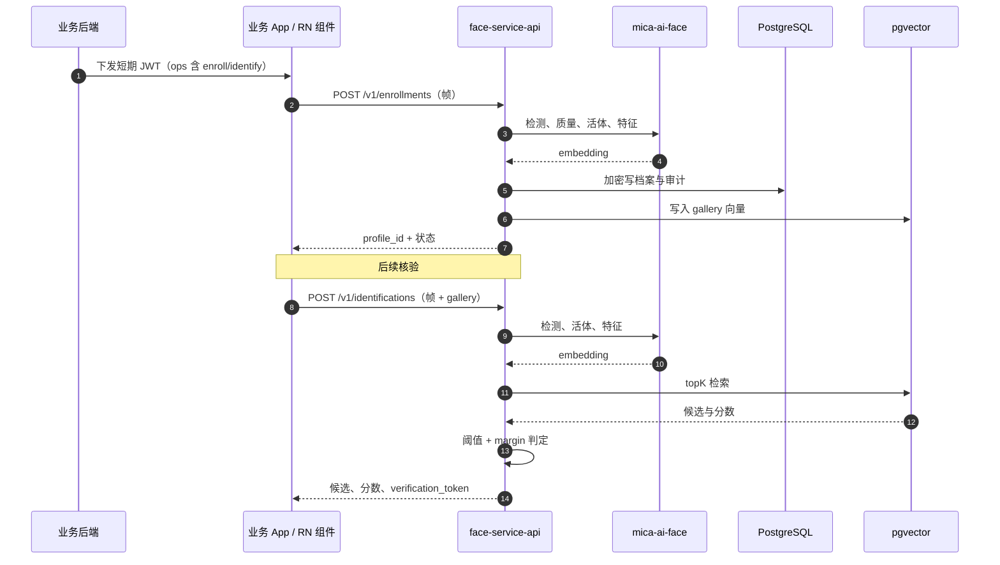
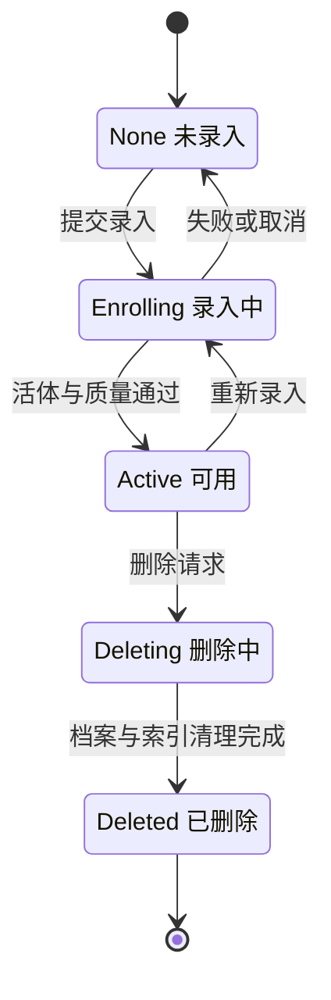

# 02 人脸档案与检索（v1）

> 文档编号：02
> 文档版本：v1
> 项目：人脸核验平台
> 关联接口：`POST /v1/enrollments`、`POST /v1/verifications`、`POST /v1/identifications`、`DELETE /v1/subjects/{subject_id}`
> 状态：设计稿，待实现
> 证据基线：技术栈切换评审（2026-11-14，Spring Boot + mica-ai-face），尚无实现代码

## 1. 流程目标

维护主体的人脸档案，并支持两种后续核验：与已录入档案做 1:1，或在指定 gallery 内做 1:N 检索。

## 2. 参与角色与前置条件

| 角色               | 职责                                        |
|--------------------|---------------------------------------------|
| 业务后端           | 签发 JWT，决定 subject、gallery 与场景      |
| 业务 App / RN 组件 | 采集帧、上传、展示结果                      |
| face-service-api   | 验签、策略校验、编排 enroll/verify/identify |
| mica-ai-face       | 检测、质量、特征、活体                      |
| pgvector           | 1:N 向量检索                                |
| PostgreSQL / Redis | 档案、gallery、审计、限流                   |

前置条件：

- 租户已启用，JWT 含 `sub` 与允许的 `ops`。
- `enroll` 需要有效的活体采集；`verify` 需要 `Active` 档案；`identify` 需要目标 gallery 有成员。
- 同一主体在同一 gallery 内只能有一个有效档案。

## 3. 主流程图

## 4. 时序图

## 5. 状态机

## 6. 关键异常与分支

| 场景                | 处理                                                 |
|---------------------|------------------------------------------------------|
| 同一主体重复 enroll | 默认覆盖旧档案，保留版本与审计；按租户策略可改为拒绝 |
| 活体或质量不通过    | 不写入档案，返回可重试错误                           |
| 档案不存在或已删除  | `verify` 返回未录入，引导先 enroll                   |
| gallery 为空        | `identify` 返回未命中，不报系统错误                  |
| 模型版本不一致      | 拒绝检索或触发重建，禁止跨版本比较特征               |
| top1 分数接近阈值   | 不自动通过，标记人工复核                             |
| margin 过小         | 视为不确定，返回多候选或人工复核                     |
| 删除与核验并发      | 以数据库事务与状态机为准，删除后不可再命中           |
| 索引更新失败        | 档案标记异常，后台重建，返回可重试错误               |

## 7. 证据索引

| 证据       | 位置                                           |
|------------|------------------------------------------------|
| 接口契约   | `docs/需求/0001/0001-人脸核验平台-实施方案.md` |
| 数据模型   | `docs/需求/0001/sql/`                          |
| 架构边界   | `docs/架构全景图.md`                           |
| 术语口径   | `docs/功能/03-领域术语表.md`                   |
| 代码与测试 | 尚不存在，待实现后补充                         |

## 8. 实现风险与待确认

- 1:N 阈值与 margin 必须用真实 gallery 校准，不能用 1:1 阈值直接套用。
- gallery 规模、是否分区、是否按租户独立索引尚未定值。
- 模型升级需要重建索引，迁移期间是否双写、是否允许旧版本继续服务需确认。
- 档案删除的审计保留范围、备份清理与合规口径需确认。
