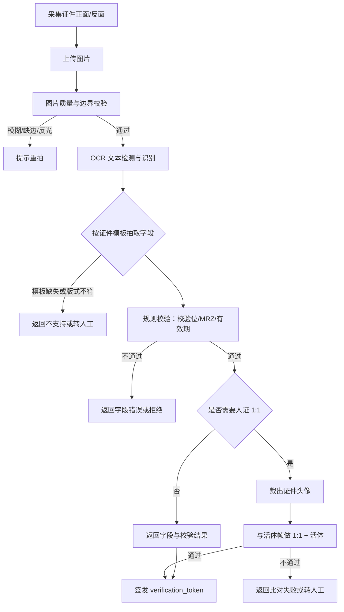
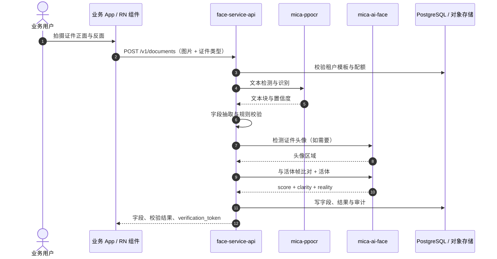
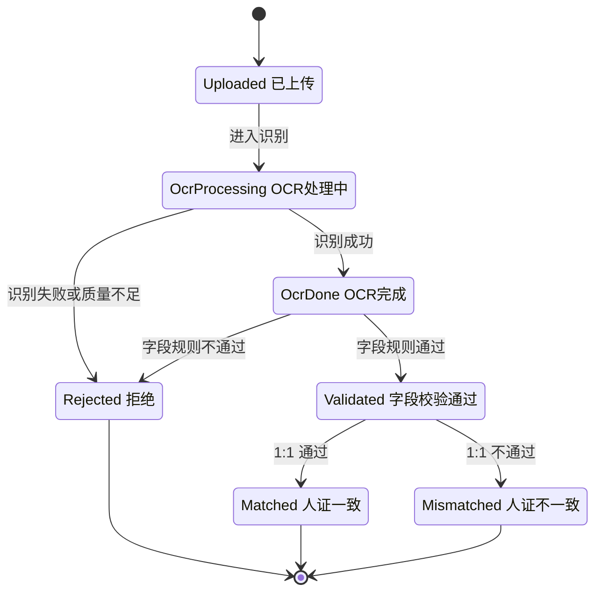

# 03 证件OCR与人证比对（v1）

> 文档编号：03
> 文档版本：v1
> 项目：人脸核验平台
> 关联接口：`POST /v1/documents`、`POST /v1/matches`
> 状态：设计稿，待实现
> 证据基线：技术栈切换评审（2026-11-14，Spring Boot + mica-ai-face），尚无实现代码

## 1. 流程目标

接收证件图片，完成 OCR、字段抽取与规则校验；在需要时裁出证件头像，与用户活体帧做 1:1，输出字段结果与核验结论。

## 2. 参与角色与前置条件

| 角色                  | 职责                                     |
|-----------------------|------------------------------------------|
| 业务用户              | 拍摄证件正反面，必要时完成活体采集       |
| 业务 App / RN 组件    | 采集、裁剪、上传、展示结果               |
| 业务后端              | 签发 JWT，决定证件类型与是否需要人证 1:1 |
| face-service-api      | 验签、模板选择、OCR、规则校验、1:1 编排  |
| mica-ppocr            | 文本检测与识别                           |
| mica-ai-face          | 证件头像检测、特征与活体                 |
| PostgreSQL / 对象存储 | 字段、审计、按策略留存图片               |

前置条件：

- 租户已配置该证件类型的模板与字段规则。
- JWT 的 `ops` 含 `document`，必要时含 `match`。
- 证件图片清晰、完整、无遮挡；图片格式与大小在限制内。
- 用户已同意证件信息的处理与留存策略。

## 3. 主流程图

## 4. 时序图

## 5. 状态机

## 6. 关键异常与分支

| 场景                 | 处理                               |
|----------------------|------------------------------------|
| 图片模糊、缺边、反光 | 质量校验拒绝，提示重拍             |
| 证件类型无模板       | 返回不支持，转人工或后续补模板     |
| OCR 置信度低         | 不自动通过，返回低置信字段并转人工 |
| 校验位/MRZ 不通过    | 判定字段错误，拒绝或转人工         |
| 证件过期             | 按租户策略拒绝或标记               |
| 证件头像缺失         | 无法做 1:1，返回明确错误           |
| 活体不通过           | 拒绝，记录审计                     |
| 字段含敏感信息       | 加密存储，日志脱敏，按策略留存     |
| OCR 服务不可用       | 返回服务不可用，不降级为“通过”     |

## 7. 证据索引

| 证据       | 位置                                           |
|------------|------------------------------------------------|
| 接口契约   | `docs/需求/0001/0001-人脸核验平台-实施方案.md` |
| 数据模型   | `docs/需求/0001/sql/face_documents.sql`        |
| OCR 选型   | `docs/需求/0001/0001-人脸核验平台-方案评估.md` |
| 术语口径   | `docs/功能/03-领域术语表.md`                   |
| 代码与测试 | 尚不存在，待实现后补充                         |

## 8. 实现风险与待确认

- OCR 只保证字段识别，不验证证件真伪；全息、UV、纸张纹理等防伪不在本期范围。
- 不同国家/地区的证件版式差异大，模板需要持续维护；首期建议只支持明确列出的证件类型。
- 证件字段属于高敏感信息，字段加密、留存期限、删除与审计范围需先确认。
- 1:1 使用的是证件头像与现场活体帧，证件头像质量差会显著影响通过率，需要质量门控与人工兜底。
