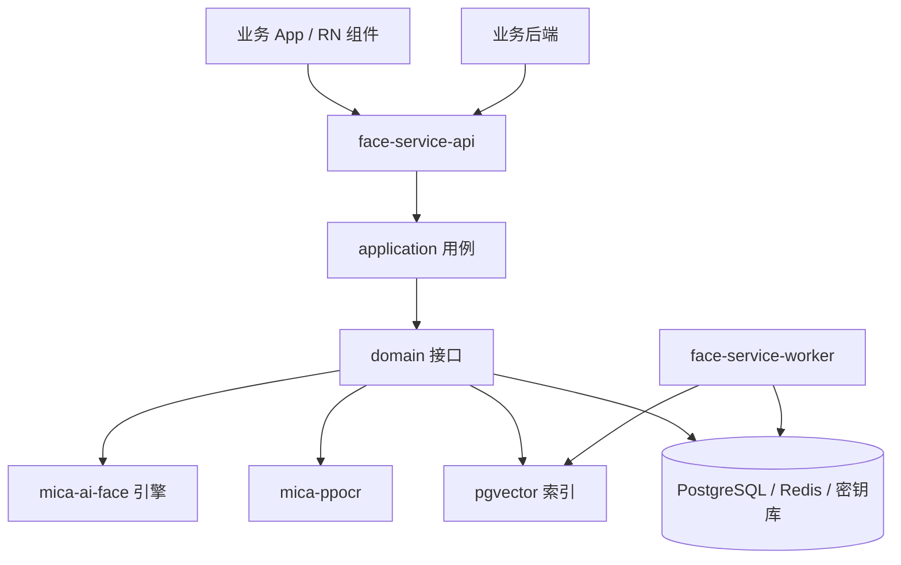

# 0001 人脸核验平台 — 实施方案

> 需求清单：[0001-人脸核验平台-需求清单.md](0001-人脸核验平台-需求清单.md)
> 方案评估：[0001-人脸核验平台-方案评估.md](0001-人脸核验平台-方案评估.md)
> 方案验收：[0001-人脸核验平台-方案验收.md](0001-人脸核验平台-方案验收.md)
> 前端对接文档：[0001-人脸核验平台-前端对接文档.md](0001-人脸核验平台-前端对接文档.md)
> 分支：N/A（独立新项目，尚未初始化 Git） ｜ 日期：2026-11-14 ｜ 状态：设计稿，待评审
> 修订：v2（2026-11-14）。技术栈由 C#/.NET 切换为 JDK 25（最低标准）+ Spring Boot 3.5.x + mica-ai-face（评估见方案评估 v2）；API
> 契约与数据模型不变。
> 修订：v2.2（2026-11-14）。移除 Kotlin Toolchain，统一标准 Maven 多模块构建（parent POM 集中仲裁版本 + `mvnw`），消除 Alpha 工具与双构建漂移。
> 修订：v2.1（2026-11-14）。最小链路落地：Kotlin Toolchain
> 五模块、/dev/token、/v1/challenges（随机主动动作序列）、/v1/action-check、/v1/enrollments、/v1/verifications、dev H5；新增错误码
> ACTION_MISMATCH；curl 与浏览器真人冒烟通过。identify/OCR/sessions/results/subjects 路由与 Worker 未实现。

## 1. 目标与范围

本期实现一套独立部署的 Java（Spring Boot）人脸核验服务，覆盖无状态 1:1、静默活体、人脸档案 1:1、1:N 检索、证件 OCR 与统一 RN
采集组件。服务按公司内部多业务共用设计，从第一天启用 `tenant_id` 隔离。

不在本期：证件真伪鉴定、跨租户检索、人工复核后台、商业 SDK、业务用户登录与业务放行。

## 2. 总体架构



分层约束：

- `api` 只做鉴权、参数校验、限流与响应；不直接调用 mica-ai 类型。
- `application` 编排会话、策略、幂等与事务。
- `domain` 定义 `FaceEngine`、`FaceIndex`、`DocumentRecognizer`、`TenantPolicy`。
- `infrastructure` 实现外部依赖（mica-ai-face、mica-ppocr、pgvector、MyBatis-Plus、Redis），可替换。
- 包结构与命名见 [01-项目架构 §2.1](../../功能/01-项目架构.md)：根包 `faceservice` 按层分包；DTO 用 `record`；配置用
  `@ConfigurationProperties` record 绑定；实现类按底层技术命名（`MicaFaceEngine` 等）。

## 3. 租户与鉴权

### 3.1 端上 JWT

业务后端使用租户注册时登记的公钥/共享密钥签发 5 分钟 JWT，App 仅持有短期 token。

| Claim     | 必填 | 说明                                                                                                  |
|-----------|------|-------------------------------------------------------------------------------------------------------|
| `iss`     | 是   | 业务方标识，如 `cpay`                                                                                 |
| `aud`     | 是   | 固定 `face-service`                                                                                   |
| `tenant`  | 是   | 租户 ID，平台只信此值                                                                                 |
| `sub`     | 是   | 业务用户 ID，平台不保存业务资料                                                                       |
| `scene`   | 是   | `kyc`、`withdraw`、`security_setting`、`large_payment`、`payment_method`                              |
| `ref`     | 否   | 业务单号或操作引用，用于绑定本次操作                                                                  |
| `ops`     | 是   | 允许的操作：`match`、`liveness`、`enroll`、`verify`、`identify`、`document`、`delete`（主体删除专用） |
| `gallery` | 否   | 1:N 检索的 gallery，必须属于该租户                                                                    |
| `device`  | 否   | 设备指纹摘要，与上传的 `device_id` 比对                                                               |
| `exp`     | 是   | 5 分钟                                                                                                |
| `jti`     | 是   | 一次性 ID，Redis 记录已用                                                                             |

校验顺序：签名 → `iss`/`aud` → `exp`/`nbf` → 租户启用与配额 → `ops` → `jti` 未使用 → `gallery` 归属 → 设备绑定。

### 3.2 服务间鉴权

- 内网 mTLS，或 `client_id + HMAC-SHA256 + timestamp + nonce`。
- 服务间接口（租户管理、结果查询、回调登记）不接受端上 JWT。
- 时间戳窗口 5 分钟，nonce 在 Redis 去重。

### 3.3 结果令牌

平台签发 `verification_token`，内容至少包含：

| 字段       | 说明                        |
|------------|-----------------------------|
| `tenant`   | 租户                        |
| `sub`      | 主体                        |
| `scene`    | 场景                        |
| `ref`      | 业务引用                    |
| `result`   | `passed` / `failed`         |
| `liveness` | `real` / `spoof` / `fuzzy`  |
| `score`    | 1:1 或 top1 分数            |
| `margin`   | 1:N 的 top1-top2 差值，可空 |
| `jti`      | 一次性 ID                   |
| `exp`      | 5 分钟                      |

业务后端验签后原子消费 `jti`；平台提供 `POST /v1/results/{jti}/consume` 或等价的内部接口。结果令牌不能替代业务鉴权。

### 3.4 开发模式

- `/dev/token` 仅在 `dev` profile 且 `auth.enable-dev-token=true` 时注册。
- dev token 固定 `tenant=dev`，不接受请求方指定租户。
- `/dev/face-test.html` 仅 dev profile 提供，不进入生产发布。
- 生产启动时若发现 `auth.enable-dev-token=true` 或 `auth.mode=dev-bypass`，直接失败。
- 不实现 Mock 引擎：`FaceEngine` 只有 mica-ai-face 真实实现，模型路径缺失启动即失败；本地开发与集成测试直接加载真实模型（openpnp
  提供 macOS/Linux 原生库，模型从上游 mica-ai 仓库获取）。
- 单元测试中的替身只在测试代码内用 Mockito stub `FaceEngine` 接口，不进入交付物；模型输出断言用阈值比较，不做精确分数断言（浮点跨平台存在微小差异）。

## 4. API 契约

### 4.1 路由总表

| 方法   | 路径                        | 鉴权     | 说明                                         |
|--------|-----------------------------|----------|----------------------------------------------|
| POST   | `/v1/sessions`              | 服务间   | 平台签发短期端上 token（可选）               |
| POST   | `/v1/challenges`            | 端上 JWT | 下发动作、帧数、nonce                        |
| POST   | `/v1/matches`               | 端上 JWT | 无状态 1:1                                   |
| POST   | `/v1/liveness-checks`       | 端上 JWT | 仅活体                                       |
| POST   | `/v1/enrollments`           | 端上 JWT | 建立/更新档案                                |
| POST   | `/v1/verifications`         | 端上 JWT | 档案 1:1                                     |
| POST   | `/v1/identifications`       | 端上 JWT | 1:N 检索                                     |
| POST   | `/v1/action-check`          | 端上 JWT | 单动作预检（分段引导用，不消费挑战、不写库） |
| POST   | `/v1/documents`             | 端上 JWT | 证件 OCR + 可选人证 1:1                      |
| GET    | `/v1/operations/{id}`       | 端上 JWT | 异步结果                                     |
| GET    | `/v1/subjects/{subject_id}` | 端上 JWT | 档案状态                                     |
| DELETE | `/v1/subjects/{subject_id}` | 端上 JWT | 合规删除                                     |
| POST   | `/v1/results/{jti}/consume` | 服务间   | 原子消费结果令牌 jti                         |
| POST   | `/dev/token`                | 无       | 仅 Development                               |
| GET    | `/dev/face-test.html`       | 无       | 仅 Development                               |

### 4.2 通用约定

- 请求头：`Authorization: Bearer <JWT>`、`X-Request-Id`、`Idempotency-Key`（写接口）。
- 上传：`multipart/form-data`；字段 `challenge_id`、`scene`、`ref`、`device_id`、`frames`、`reference`（match）、`document_type`
  （documents）。
- 单帧限制 2MB，单请求总大小限制 20MB，最多 15 帧。
- 响应：`{code, message, data, request_id}`；`code=0` 表示成功。实现上由 `@RestControllerAdvice` + `ErrorCode`
  枚举统一转换，业务异常继承 `FaceServiceException`；错误码值保持本契约不变。
- 异步：请求带 `Prefer: respond-async` 时返回 `202` 与 `operation_id`，完成后回调或轮询。

### 4.3 挑战接口

`POST /v1/challenges`

请求字段：

| 字段        | 类型   | 必填 | 说明                                                                 |
|-------------|--------|------|----------------------------------------------------------------------|
| `scene`     | string | 是   | 场景，必须与 JWT 一致                                                |
| `ref`       | string | 否   | 业务引用，必须与 JWT 一致                                            |
| `mode`      | string | 是   | `match` / `liveness` / `enroll` / `verify` / `identify` / `document` |
| `gallery`   | string | 否   | `identify` 必填，必须属于 JWT 租户                                   |
| `device_id` | string | 是   | 设备指纹摘要                                                         |

响应字段：

| 字段           | 类型     | 说明                                                                                           |
|----------------|----------|------------------------------------------------------------------------------------------------|
| `challenge_id` | string   | 一次性挑战 ID                                                                                  |
| `actions`      | string[] | 主动动作序列（随机）：`straight` 打底 + 从 `turn_left`/`turn_right`/`mouth_open` 随机取 N-1 个 |
| `frame_count`  | number   | 需要采集的帧数，6–15                                                                           |
| `expires_at`   | string   | ISO 8601，默认 5 分钟                                                                          |
| `nonce`        | string   | 服务端随机串，随帧回传                                                                         |

### 4.4 无状态 1:1

`POST /v1/matches`

| 字段           | 类型   | 必填 | 说明                           |
|----------------|--------|------|--------------------------------|
| `challenge_id` | string | 是   | 挑战 ID                        |
| `scene`        | string | 是   | 场景                           |
| `ref`          | string | 否   | 业务引用                       |
| `device_id`    | string | 是   | 设备指纹                       |
| `frames`       | file[] | 是   | 现场帧，数量等于 `frame_count` |
| `reference`    | file   | 是   | 参考图，如证件头像             |

响应：`result`（`passed`/`failed`）、`score`、`liveness`、`clarity`、`reality`、`verification_token`、`request_id`。

### 4.5 静默活体

`POST /v1/liveness-checks`

| 字段           | 类型   | 必填 | 说明     |
|----------------|--------|------|----------|
| `challenge_id` | string | 是   | 挑战 ID  |
| `frames`       | file[] | 是   | 连续帧   |
| `device_id`    | string | 是   | 设备指纹 |

响应：`result`、`clarity`、`reality`、`status`（`real`/`spoof`/`fuzzy`/`detecting`）、`request_id`。

### 4.6 人脸档案

`POST /v1/enrollments`

| 字段           | 类型   | 必填 | 说明                               |
|----------------|--------|------|------------------------------------|
| `challenge_id` | string | 是   | 挑战 ID                            |
| `frames`       | file[] | 是   | 活体帧                             |
| `gallery`      | string | 否   | 需要加入的 gallery，默认 `default` |
| `device_id`    | string | 是   | 设备指纹                           |

响应：`profile_id`、`status`（`active`/`pending`）、`model_version`、`request_id`。

`POST /v1/verifications`

| 字段           | 类型   | 必填 | 说明     |
|----------------|--------|------|----------|
| `challenge_id` | string | 是   | 挑战 ID  |
| `frames`       | file[] | 是   | 活体帧   |
| `device_id`    | string | 是   | 设备指纹 |

响应：`result`、`score`、`liveness`、`verification_token`、`request_id`。

### 4.7 1:N 检索

`POST /v1/identifications`

| 字段           | 类型   | 必填 | 说明                            |
|----------------|--------|------|---------------------------------|
| `challenge_id` | string | 是   | 挑战 ID                         |
| `gallery`      | string | 是   | 目标 gallery，必须属于 JWT 租户 |
| `top_k`        | number | 否   | 默认 5，最大 20                 |
| `frames`       | file[] | 是   | 活体帧                          |
| `device_id`    | string | 是   | 设备指纹                        |

响应：`matched`、`candidates`（`subject_id`、`score`）、`top1_score`、`margin`、`decision`（`passed`/`review`/`no_match`）、
`verification_token`、`request_id`。

### 4.8 证件 OCR

`POST /v1/documents`

| 字段            | 类型   | 必填 | 说明                                       |
|-----------------|--------|------|--------------------------------------------|
| `document_type` | string | 是   | 如 `cn_id_front`、`cn_id_back`、`passport` |
| `images`        | file[] | 是   | 证件图片，按证件类型 1–2 张                |
| `challenge_id`  | string | 否   | 需要人证 1:1 时必填                        |
| `frames`        | file[] | 否   | 人证 1:1 的现场帧                          |
| `device_id`     | string | 是   | 设备指纹                                   |

响应：`document_type`、`fields`（字段键值）、`validation`（`checksum`/`mrz`/`expiry`）、`face_match`（可空）、`verification_token`、
`request_id`。

### 4.9 异步与查询

- 长任务返回 `202`：`{operation_id, status:"processing"}`。
- `GET /v1/operations/{id}` 返回 `status`、`result`、`error`、`request_id`。
- `GET /v1/subjects/{subject_id}` 返回档案状态与 `model_version`，不返回特征。
- `DELETE /v1/subjects/{subject_id}` 返回 `deleted` 与清理项摘要。

## 5. 数据模型

### 5.1 表清单

本平台所有表统一加 `face_` 前缀：平台与 cpay-api 共用同一个数据库实例，前缀用于命名空间隔离，避免表名、索引名与序列名冲突。

| 表                           | 作用                  | SQL                                                 |
|------------------------------|-----------------------|-----------------------------------------------------|
| `face_tenants`               | 租户与策略            | `docs/需求/0001/sql/face_tenants.sql`               |
| `face_tenant_keys`           | 租户密钥密文与版本    | `docs/需求/0001/sql/face_tenant_keys.sql`           |
| `face_subjects`              | 主体与状态            | `docs/需求/0001/sql/face_subjects.sql`              |
| `face_profiles`              | 加密特征与模型版本    | `docs/需求/0001/sql/face_profiles.sql`              |
| `face_galleries`             | 1:N 人脸库与阈值      | `docs/需求/0001/sql/face_galleries.sql`             |
| `face_gallery_members`       | gallery 成员与向量    | `docs/需求/0001/sql/face_gallery_members.sql`       |
| `face_verification_sessions` | 会话、challenge、结果 | `docs/需求/0001/sql/face_verification_sessions.sql` |
| `face_documents`             | 证件字段与校验结果    | `docs/需求/0001/sql/face_documents.sql`             |
| `face_consents`              | 同意与撤回            | `docs/需求/0001/sql/face_consents.sql`              |
| `face_audit_logs`            | 审计                  | `docs/需求/0001/sql/face_audit_logs.sql`            |
| `face_operations`            | 异步任务状态与结果    | `docs/需求/0001/sql/face_operations.sql`            |

### 5.2 关键字段

| 表                           | 关键字段                                                                                               |
|------------------------------|--------------------------------------------------------------------------------------------------------|
| `face_tenants`               | `id`、`code`、`status`、`policy_json`、`created_at`                                                    |
| `face_tenant_keys`           | `tenant_id`、`key_version`、`key_cipher`、`status`、`created_at`                                       |
| `face_subjects`              | `tenant_id`、`external_subject_id`、`status`、`created_at`、`deleted_at`                               |
| `face_profiles`              | `subject_id`、`embedding_cipher`、`model_version`、`status`、`updated_at`                              |
| `face_galleries`             | `tenant_id`、`name`、`threshold`、`margin`、`model_version`                                            |
| `face_gallery_members`       | `gallery_id`、`subject_id`、`embedding`、`model_version`                                               |
| `face_verification_sessions` | `challenge_id`、`tenant_id`、`subject_id`、`scene`、`ref`、`status`、`score`、`liveness`、`expires_at` |
| `face_documents`             | `subject_id`、`document_type`、`fields_cipher`、`validation_json`、`status`、`retention_until`         |
| `face_consents`              | `subject_id`、`policy_version`、`agreed_at`、`revoked_at`                                              |
| `face_audit_logs`            | `tenant_id`、`actor`、`action`、`resource`、`result`、`request_id`、`created_at`                       |

### 5.3 向量维度

mica-ai-face 的 SFace 输出固定 **128d L2 归一化向量**。`face_gallery_members.embedding` 的 `vector(N)` 维度必须与模型输出一致，示例
DDL 使用 `vector(128)`；服务启动时仍探测校验，不一致直接失败；未确认前不要在生产建索引。模型升级改变维度时按索引重建流程迁移。

## 6. 核心实现

### 6.1 人脸流水线

```java
// infrastructure 层 MicaFaceEngine 内部（业务层只看到 FaceEngine 接口）
List<FaceBox> faces = detector.detect(image);
if (faces.size() != 1) return Error(ErrorCode.NO_FACE_OR_MULTI_FACE);

try (Mat aligned = aligner.align(image, faces.get(0))) {
    float[] embedding = extractor.extract(aligned);        // SFace 128d，L2 归一化
    LivenessResult liveness = livenessDetector.detect(image, faces.get(0));
    if (!liveness.isReal()) return Error(ErrorCode.LIVENESS_FAILED);

    double score = faceVerifier.compare(referenceEmbedding, embedding); // 余弦相似度
    boolean passed = score >= policy.matchThreshold();      // 默认 0.35，按租户覆盖
}
```

约束：

- 引擎能力来自 mica-ai-face 的 `FaceDetector` / `FaceAligner` / `FeatureExtractor` / `LivenessDetector` / `FaceVerifier`
  Bean；业务层只依赖 `FaceEngine` 接口。
- 模型路径通过 `mica.ai.face.model.*` 配置，缺省即启动失败；模型版本与 sha256 一并校验。
- 活体按帧判定（MiniFASNetV2，80x80 裁剪、`crop-scale=2.7`），多帧结果由应用层投票：任一 `spoof` 即拒绝，`fuzzy`
  占比超阈值则要求重拍；滑动窗口不跨用户复用。
- 活体返回 `fuzzy` 时引导重拍，不计入失败次数；返回 `spoof` 时记录风控。
- 相似度为余弦值，1:1 默认阈值 0.35（mica-ai 默认，需样本校准）；按租户可覆盖。
- 主动动作活体（v2.1 新增）：挑战下发随机动作序列（straight 打底 + 随机转向/张嘴），服务端基于 YuNet 5 点几何逐段校验（转头看
  yaw 比、张嘴看鼻唇距相对 straight 段基线的增幅），每段 ≥50% 帧达标才通过；页面经 `/v1/action-check` 分段预检做引导（不消费挑战），最终整单在
  enroll/verify 内复验；全帧静默活体（MiniFASNetV2）独立叠加。

### 6.2 阈值与策略

| 配置                                          | 默认           | 说明                                                     |
|-----------------------------------------------|----------------|----------------------------------------------------------|
| `face.match-threshold`                        | 0.35           | 1:1 余弦相似度阈值（mica-ai 默认，待校准）               |
| `face.liveness.threshold`                     | 0.85           | MiniFASNetV2 活体阈值（mica-ai 默认）                    |
| `face.liveness.frame-count`                   | 10             | 活体融合帧数，6–15，多帧投票                             |
| `face.liveness.fuzzy-ratio`                   | 待校准         | `fuzzy` 帧占比上限，超过要求重拍                         |
| `face.identify.threshold`                     | 待校准         | 1:N 不准直接套用 1:1 阈值                                |
| `face.identify.margin`                        | 待校准         | top1 与 top2 的最小差值                                  |
| `mica.ai.face.detection.threshold`            | 0.9            | YuNet 检测置信度阈值                                     |
| `mica.ai.face.verify.strategy`                | `LARGEST_AREA` | 多脸选脸策略；KYC 场景建议 `REJECT`                      |
| `faceservice.challenge.actions-count`         | 3              | 主动动作段数（straight 打底 + 随机 2）                   |
| `faceservice.challenge.frames-per-action`     | 5              | 每动作段采集帧数（页面按 550ms/帧匀速采集，段窗口约 3s） |
| `faceservice.face.yaw-threshold`              | 0.20           | 转头判定（基于 YuNet 5 点几何 yaw 比）                   |
| `faceservice.face.straight-yaw`               | 0.15           | 正视判定                                                 |
| `faceservice.face.mouth-open-ratio`           | 1.08           | 张嘴判定（相对 straight 段基线）                         |
| `faceservice.face.action-pass-ratio`          | 0.5            | 每段满足动作的帧占比下限                                 |
| `faceservice.challenge.action-verify-enabled` | true           | 关闭后退化为正视单段（静态样例冒烟用）                   |

1:N 的阈值与 margin 首期不写死默认值，必须用目标 gallery 的真实样本校准后写入租户策略。

### 6.3 会话与活体状态

- `challenge_id` 在 Redis 保存状态、帧数、动作、设备绑定与 TTL。
- 帧随单次请求整体上传，按顺序逐帧活体判定并投票，判定无跨请求状态；如需分批上传，同一 `challenge_id` 的中间状态落 Redis
  并串行化。
- 会话一次性：处理完成或过期后不可复用；`jti` 成功后写入已用集合。
- 多实例部署时，ONNX 会话进程内共享、推理线程安全；跨实例无需粘性路由，Redis 原子性经 `StringRedisTemplate` + Lua 脚本（
  `SET NX EX` 领取 challenge、Lua 比对并消费 jti）保证。

### 6.4 证件 OCR

```java
// infrastructure 层 PpocrDocumentRecognizer 内部（业务层只看到 DocumentRecognizer 接口）
OcrResult ocr = ppocrEngine.recognize(image);            // mica-ppocr：文本检测 + 识别 + 置信度
Map<String, FieldValue> fields = template.extract(ocr, documentType);
ValidationResult validation = validator.validate(fields, documentType);
BufferedImage face = documentFaceCropper.crop(image, fields);
FaceMatch match = face == null ? null : faceEngine.match(face, probeEmbedding);
```

- 模板与字段规则放数据库/配置，不写死在代码。
- 校验项：身份证校验位、护照 MRZ、有效期、字段一致性。
- OCR 置信度低于阈值时不自动通过，返回 `DOCUMENT_LOW_CONFIDENCE` 并转人工。
- 证件字段加密存储；原图按租户留存策略处理。

### 6.5 1:N 检索

- 只检索 JWT 授权的 gallery，查询强制带 `tenant_id`——由 MyBatis-Plus `TenantLineInnerInterceptor` 从 JWT 上下文统一注入，不依赖各
  SQL 手写条件。
- 先按 `model_version` 过滤，禁止跨版本比较特征。
- topK 结果同时校验 `top1` 阈值与 `margin`；不满足则返回 `review` 或 `no_match`。
- 接近阈值的命中不自动放行，进入人工复核或要求二次活体。
- 模型升级时先重建索引，双写/回填完成后再切换读路径。

### 6.6 加密与密钥

- 特征与证件字段使用 AES-GCM 加密（JDK 内置 `javax.crypto`，无第三方依赖），密文包含 `key_version` 与 nonce。
- 密钥库落库（`DbKeyStore` 实现）：租户密钥存 `face_tenant_keys`，密钥密文由主密钥包裹；主密钥只从环境变量注入，不进数据库与代码库。
- 密钥不可用即拒绝写入，不降级明文。
- 日志、异常、审计不输出特征、证件号、姓名、JWT 原文。
- 删除时同时清理密文、索引、原图与可删除审计字段。

### 6.7 异步任务

- API 接收异步请求后写入 `face_operations` 表并投递到有界队列（显式构造的 `ThreadPoolExecutor` + 有界 `BlockingQueue`
  ，队列满快速失败并提示稍后重试）。
- Worker 幂等消费，按 `operation_id` 更新状态：`queued → running → succeeded/failed`（数据库状态机 + 乐观锁防重复消费）。
- 重试次数、退避与死信阈值配置化；超过阈值标记失败并告警。
- 定时清理（会话过期、留存到期、索引重建）用 `@Scheduled` 实现，幂等可重入。
- `GET /v1/operations/{id}` 只允许同一租户、同一主体查询。

## 7. RN 组件与本地 H5

### 7.1 统一 RN 组件

```ts
interface FaceVerifyProps {
  endpoint: string;
  token: string;
  mode: 'match' | 'liveness' | 'enroll' | 'verify' | 'identify' | 'document';
  scene: string;
  ref?: string;
  gallery?: string;
  locale?: string;
  onSuccess: (result: FaceVerifyResult) => void;
  onError: (error: FaceVerifyError) => void;
}
```

- 基于现有 `expo-camera`，不引入 VisionCamera v5 或 Nitro。
- 组件内部：申请 challenge → 展示动作 → 连拍 N 帧 → multipart 上传 → 解析错误 → 回调。
- 不在端上做活体或比对；不缓存帧；上传后删除临时文件。
- Web 端按服务端策略降级为密码/验证码；需要时用 WebView 打开托管 H5。

### 7.2 本地 H5 验证

- `face-service-api/resources/static/dev/face-test.html` 与 API 同源，避免 CORS。
- `POST /dev/token` 仅在 `dev` profile + `auth.enable-dev-token=true` 双条件下可用，签发 `tenant=dev` 的 5 分钟 JWT。
- H5 使用 `getUserMedia` + canvas 连拍，走与线上相同的 challenge/verify 接口。
- `getUserMedia` 需要 `localhost` 或 HTTPS；局域网 IP 必须 HTTPS。
- 验证完成后切回真实 JWT 路径，并确认 `/dev/*` 在生产不可用。

## 8. 配置项

Spring 配置属性（kebab-case，环境变量用大写下划线映射，如 `AUTH_MODE`）：

| 配置组                  | 关键字段                                                                                                                                                                   | 说明                                                                                  |
|-------------------------|----------------------------------------------------------------------------------------------------------------------------------------------------------------------------|---------------------------------------------------------------------------------------|
| `auth.*`                | `mode`、`enable-dev-token`、`dev-signing-key`、`result-token-signing-key`                                                                                                  | 生产只允许 `jwt`；DevToken 双条件（dev profile + 开关）                               |
| `face.*`                | `match-threshold`、`liveness.threshold`、`liveness.frame-count`、`identify.threshold`、`identify.margin`、`identify.top-k`                                                 | 判定阈值与帧数策略；引擎只有 mica-ai-face 真实实现，无 Mock                           |
| `mica.ai.face.*`        | `model.detection.path`、`model.recognition.path`、`model.liveness.path`、`detection.threshold`、`liveness.threshold`、`verify.threshold`、`verify.strategy`、`onnx.device` | mica-ai-face 引擎参数；模型路径缺失启动失败                                           |
| `spring.datasource.*`   | `url`、`username`、`password`                                                                                                                                              | PostgreSQL 连接                                                                       |
| `face.vector.dimension` | `128`                                                                                                                                                                      | 必须与 pgvector 列维度一致，启动探测校验                                              |
| `spring.data.redis.*`   | `host`、`port`、`password`、`challenge-ttl`、`jti-ttl`                                                                                                                     | 会话与防重放                                                                          |
| `storage.*`             | `enabled`、`endpoint`、`bucket`、`region`、`access-key`、`secret-key`、`force-path-style`、`signed-url-ttl`                                                                | 本地开发 RustFS、线上 Cloudflare R2，同一 S3 兼容实现（AWS SDK v2）；凭据只走环境变量 |
| `retention.*`           | `session-hours`、`image-days`、`profile-days`                                                                                                                              | 留存与清理                                                                            |
| `security.*`            | `master-key`、`allowed-origins`、`max-upload-bytes`                                                                                                                        | 租户密钥落库（`face_tenant_keys`，主密钥环境变量注入）；凭据只走环境变量              |

## 9. 错误码

| 错误码                    | HTTP | 含义                              | 可重试           |
|---------------------------|------|-----------------------------------|------------------|
| `AUTH_INVALID`            | 401  | JWT 无效、过期或签名错误          | 否               |
| `TENANT_DISABLED`         | 403  | 租户停用或无权限                  | 否               |
| `QUOTA_EXCEEDED`          | 429  | 超过租户配额                      | 是，退避后重试   |
| `CHALLENGE_EXPIRED`       | 409  | challenge 过期或已使用            | 是，重新申请     |
| `CHALLENGE_REPLAY`        | 409  | jti 或 challenge 重放             | 否               |
| `NO_FACE`                 | 422  | 未检测到人脸                      | 是，重拍         |
| `MULTI_FACE`              | 422  | 检测到多张人脸                    | 是，重拍         |
| `LOW_QUALITY`             | 422  | 清晰度不足（Fuzzy）               | 是，补光重拍     |
| `LIVENESS_FAILED`         | 422  | 活体不通过                        | 是，限次         |
| `ACTION_MISMATCH`         | 422  | 主动动作未完成（转头/张嘴未达标） | 是，按提示重试   |
| `FACE_MISMATCH`           | 422  | 1:1 相似度不足                    | 是，限次         |
| `FACE_NOT_ENROLLED`       | 404  | 未录入档案                        | 否，先 enroll    |
| `GALLERY_NOT_FOUND`       | 404  | gallery 不存在或越权              | 否               |
| `IDENTIFY_REVIEW`         | 200  | 接近阈值，需人工复核              | 否               |
| `DOCUMENT_UNSUPPORTED`    | 422  | 证件类型无模板                    | 否               |
| `DOCUMENT_LOW_CONFIDENCE` | 422  | OCR 置信度低                      | 是，重拍或转人工 |
| `DOCUMENT_INVALID`        | 422  | 校验位/MRZ/有效期不通过           | 否               |
| `SERVICE_UNAVAILABLE`     | 503  | 模型或依赖不可用                  | 是，退避后重试   |
| `DEV_DISABLED`            | 404  | 非 dev profile                    | 否               |

## 10. 观测点

- 指标：Micrometer 暴露请求量、成功率、P50/P95 延迟、活体拒绝率、Fuzzy 率、1:1 分数分布、1:N margin 分布、OCR 置信度分布、各错误码计数。
- 日志：SLF4J 占位符输出；`request_id` 经 Servlet 过滤器写入 MDC 贯通全链路，附带 `tenant`、`scene`、`mode`
  、耗时、结果、错误码；不记录图片、特征、证件字段。
- 链路：OpenTelemetry（javaagent 零代码接入）；跨 API、Worker、数据库、模型调用传递 trace。
- 审计：谁在何时对哪个主体做了什么核验、结果如何、是否删除、是否人工复核。

## 11. 改动清单

标准 Maven 多模块（parent `pom.xml` 集中仲裁版本 + `mvnw`，JDK 25，命令 `./mvnw -DskipTests package`）：

| 路径（规划）                                           | 改动                                                                                                                                                                               |
|--------------------------------------------------------|------------------------------------------------------------------------------------------------------------------------------------------------------------------------------------|
| `pom.xml`（parent）+ `mvnw`                            | 模块聚合、SB BOM 3.5.7 集中仲裁依赖版本、spring-boot-maven-plugin、编译 release 25                                                                                                 |
| `face-service-api/`                                    | Spring Boot 入口、`*Controller` 路由、安全过滤链、限流、Actuator 健康探针、springdoc OpenAPI                                                                                       |
| `face-service-api/resources/static/dev/face-test.html` | 本地 H5                                                                                                                                                                            |
| `face-service-application/`                            | `MatchService`/`EnrollService`/`VerifyService`/`LivenessService`/`IdentifyService`/`DocumentService` 用例                                                                          |
| `face-service-domain/`                                 | 领域接口（`FaceEngine` 等）、实体、值对象、策略                                                                                                                                    |
| `face-service-infrastructure/`                         | `MicaFaceEngine`（mica-ai-face）、`PpocrDocumentRecognizer`（mica-ppocr）、`PgFaceIndex`（MyBatis-Plus Mapper + 向量 TypeHandler）、Redis、`DbKeyStore`（落库）、`S3ObjectStorage` |
| `face-service-worker/`                                 | 队列消费、`@Scheduled` 清理、索引重建                                                                                                                                              |
| `face-service-contracts/`                              | DTO（record）、`ErrorCode` 枚举、OpenAPI 契约                                                                                                                                      |
| `deploy/Dockerfile`                                    | eclipse-temurin（Debian/Ubuntu glibc）多阶段镜像                                                                                                                                   |
| `deploy/docker-compose.dev.yml`                        | 本地开发 RustFS（S3 兼容对象存储）                                                                                                                                                 |
| `docs/需求/0001/sql/`                                  | 表结构 DDL                                                                                                                                                                         |

各模块单元测试位于模块内 `src/test/java`（Maven-like layout），集成测试使用 Testcontainers（PostgreSQL +
Redis）。当前以上文件均未创建，清单用于 implementation 阶段的任务拆分。

## 12. 边界与非目标

- 平台不做业务用户鉴权、业务放行、账户体系。
- 平台不验证证件真伪，不提供全息/UV/芯片读取。
- 平台不跨租户检索；gallery 必须属于 JWT 租户。
- 首期不做人工复核后台；只提供结果、审计与 `review` 标记。
- 不引入商业 SDK、云人脸 API 或研究限制权重。
- 不把原始帧暴露为公网 URL；对象存储使用私有读与短时效签名。

## 13. 待办

| 项                | 说明                                                                                                                                     |
|-------------------|------------------------------------------------------------------------------------------------------------------------------------------|
| **补测试**        | 单元（Mockito stub 接口）+ 集成（Testcontainers）覆盖已实现五路由——当前最大缺口                                                          |
| 阈值校准          | 0.35/0.85/0.20/0.15/1.08 均为初始默认；用真实设备与人群样本确定 1:1、动作、1:N 阈值与 margin（错误消息已带实测数值，便于校准）           |
| 剩余路由          | sessions、matches、liveness-checks、identifications（含 PgFaceIndex）、documents（含 mica-ppocr）、operations、subjects、results/consume |
| Worker            | 异步任务、会话/留存清理、索引重建模块                                                                                                    |
| 对象存储          | S3ObjectStorage（RustFS/R2）随原图留存策略落地                                                                                           |
| 证件类型          | 确认首期支持的证件与模板                                                                                                                 |
| 留存策略          | 确认原图、特征、审计的留存与删除时限                                                                                                     |
| 设备指纹          | 与 RN 端统一 `device_id` 生成方式（当前 H5 用会话级随机占位）                                                                            |
| 1:N 规模          | 确认 gallery 规模、分区与扩容方案                                                                                                        |
| 模型许可          | 建立 `MODEL_LICENSES.md` 并随模型入库（eDifFIQA-Tiny CC-BY-4.0 署名）                                                                    |
| 部署              | Dockerfile（eclipse-temurin）、限流、springdoc OpenAPI、生产配置校验                                                                     |
| mica-ppocr 许可证 | 落地 OCR 前核对 mica-ppocr 仓库 LICENSE 与 NOTICE                                                                                        |

## 14. 验收结论

本方案为设计稿，尚未实现；验收条件与未执行项见 [方案验收](0001-人脸核验平台-方案验收.md)。
